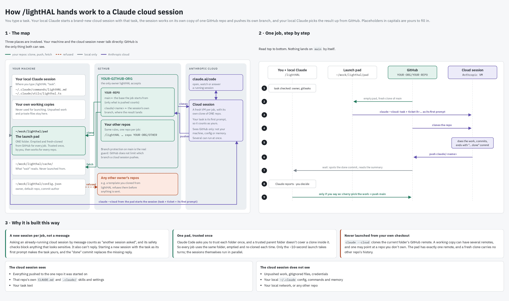

# lightHAL



`/lightHAL` is a Claude Code command that hands a task to a **new Claude cloud session** and brings the result back
through GitHub: the session pushes its own `claude/*` branch, and the command watches for it and reports.

```
/lightHAL "task" → new cloud session (task = its first prompt) → it works, pushes claude/<branch>
                 → your local session watches GitHub → reports branch, summary, commits, files
```

## What's in this repo

| File | Put it at |
|---|---|
| `commands/lightHAL.md` | `~/.claude/commands/lightHAL.md` |
| `utils/lighthal.ts` | `~/.claude/utils/lighthal.ts` |
| `utils/lighthal.test.ts` | `~/.claude/utils/lighthal.test.ts` (optional) |
| `docs/` | nothing to install: the overview picture as HTML and JPEG |

## Requirements

- Linux (tested) or macOS (the BSD `script` path is written but untested).
- `bun`, `git`, `gitleaks`, `script`.
- The `claude` CLI signed in with a claude.ai account (`claude auth status`), on a plan with cloud sessions.
- GitHub connected for cloud sessions (claude.ai/code onboarding, or `/web-setup`), with push access to your repos.

## Setup

1. Copy the files as in the table, then `chmod +x ~/.claude/utils/lighthal.ts`.
2. Create `~/work/lighthal/config.json`:

   ```json
   {
     "owner": "YOUR-GITHUB-ORG",
     "defaultRepo": "YOUR-REPO",
     "author": "YOUR NAME <YOUR-GITHUB-NOREPLY-EMAIL>"
   }
   ```

   `owner` is required: the only GitHub user or org whose repos the command will use. `author` is optional; set it
   if GitHub refuses pushes with your private email.
3. Optional check: `bun test ~/.claude/utils/lighthal.test.ts` (offline, no cloud session).
4. **Trust the launch folder once.** Every job is launched from one folder, `~/work/lighthal/pad`. Your first
   `/lightHAL` stops with exit 3, "pad not trusted" (the clone it made is waiting there). Run
   `cd ~/work/lighthal/pad && claude`, pick "Yes, I trust this folder", then `/exit`, and run `/lightHAL` again.
   Trust is tied to the folder's path, so this is needed once, for every repo. The script never answers it for you.
5. Try it: `/lightHAL write hello.md at the repo root with the current UTC time`.

## Good to know

- **Each run creates a cloud session**, which counts toward your plan's usage.
- **It never launches from your own checkout.** `claude --cloud` clones the current directory's GitHub remote, so
  each job empties `~/work/lighthal/pad` and fresh-clones the target repo into it. A fresh clone carries no other
  repo's history and none of your local files.
- **Many jobs can run at once.** Only the ~10-second launch takes turns (a second start waits or retries); once
  launched, each session works in the cloud on its own copy.
- **A session sees only the one repo it was started on**: no local files, no `~/.claude` config, no memory. Put the
  context it needs into the task, or give that repo its own `CLAUDE.md`.
- **The summary comes back in an empty final commit** (`lightHAL <ticket> done`), so cherry-picking the work never
  drags a report file along.
- **GitHub doesn't stop a cloud session pushing to `main`.** The task footer tells it to push only its own branch, and
  `wait` warns if any other branch moved. Branch protection is the real guard.
- `claude --cloud` refuses to run without a terminal, so the script runs it under `script`. A CLI update that changes
  its output shows up as exit 3 with the log tail.

## Licence

MIT. See [LICENSE](LICENSE).
